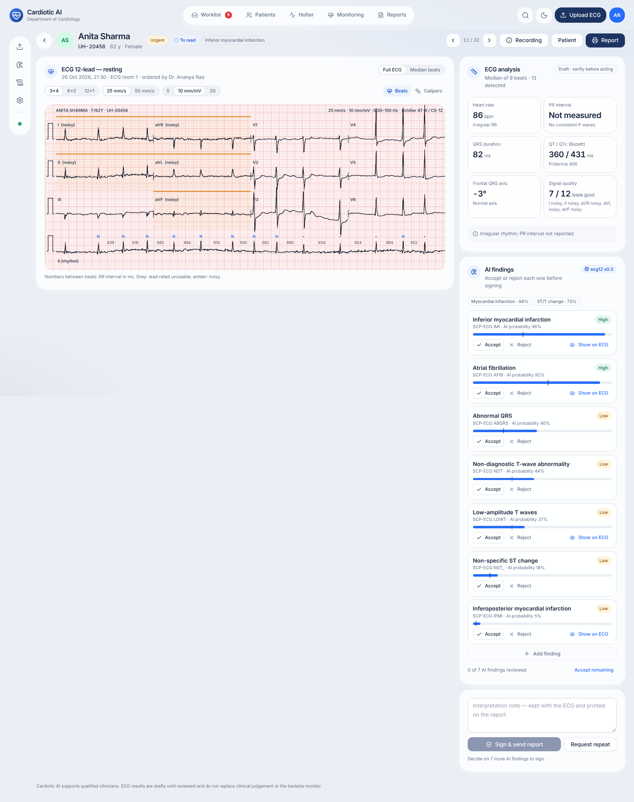

# Cardiotic AI

AI-assisted ECG analysis and cardiac monitoring for hospitals, ICUs and operation theatres.
For hospitals and medical-equipment manufacturers. On-premise. Markets: India and USA first, then EU.

> **Status: working system, not yet validated or cleared for clinical use.** The AI (signal quality,
> heartbeat detection, beat classification, rhythm, 12-lead measurements and 71 diagnostic statements) is
> measured on public data, on patients the models never saw ([ml/reports/RESULTS.md](ml/reports/RESULTS.md)).
> Around it runs a complete on-premise product: ECG file readers (DICOM, HL7 aECG, GE MUSE, Philips, SCP-ECG, EDF, CSV,
> and paper ECGs as PDF or image), machine feeds (folder, DICOM), HIS links in both directions (ADT and orders in, signed
> reports with PDF out), accounts with LDAP, OpenID Connect and two-factor sign-in, reading and sign-off, audit log, 24 h Holter,
> Live Assist for OT/ICU, install and backup tools. What this repository cannot contain is listed in
> [What this repository does not contain](#what-this-repository-does-not-contain).

## Start here

| | |
|---|---|
| [docs/AI_ML_ROADMAP.md](docs/AI_ML_ROADMAP.md) | **The AI**: every model, what it learns from, how it is tested, build order |
| [deploy/INSTALL.md](deploy/INSTALL.md) | **Installing at a hospital**: requirements, install, site set-up, HIS, backup, security checklist |
| [server/](server/) | **The server**: accounts, upload and analysis, review and sign-off, audit chain, HL7/FHIR delivery ([API and rules](server/README.md)) |
| [frontend/](frontend/) | **The web app**: worklist, 12-lead review, Holter, reports, settings. One build runs against the server or, without one, on recorded sample data ([how to run](frontend/README.md)) |
| [engine/](engine/) | **The AI engine**: ONNX models with integrity checks, ECG file readers, per-site operating points, HTTP API ([API](engine/README.md)) |
| [ml/](ml/) | AI research code: data loaders, signal processing, models, training, evaluation ([how to run](ml/README.md)) |
| [ml/reports/RESULTS.md](ml/reports/RESULTS.md) | Measured results on patients the models never saw |
| [docs/01_FEATURES_AND_LOGIC.md](docs/01_FEATURES_AND_LOGIC.md) | Every feature, how it works, the rules and logic behind it |
| [docs/02_REMAINING_DEVELOPMENT.md](docs/02_REMAINING_DEVELOPMENT.md) | Engineering work still open, prioritised |
| [docs/03_MANAGEMENT_ACTIONS.md](docs/03_MANAGEMENT_ACTIONS.md) | What the owner and management must do: regulatory, clinical, legal, security, people |
| [docs/04_ARCHITECTURE.md](docs/04_ARCHITECTURE.md) | Architecture, modules, API, database, deployment, tests |
| [docs/PRODUCT_PLAN.md](docs/PRODUCT_PLAN.md) | Review of the original research, product definition, regulatory path, data, AI/ML design, architecture, roadmap, team, risks and **open decisions** (section 14) |
| [docs/ui-concept/index.html](docs/ui-concept/index.html) | Earlier static UI concept (superseded by frontend/). Open it in a browser; switch screens with the bar at the top and switch theme with the moon icon |

## Product line

| | Product | What it does |
|---|---|---|
| A | **ECG Review** | Recorded 12-lead and long ECGs: signal quality, measurements (rate, PR, QRS, QT/QTc, axis), rhythm findings, clinician review and signed reports. First commercial product |
| B | **Live Assist** | Advisory review flags from live monitor streams, beside (never instead of) the bedside monitor's alarms. Silent-mode study first |
| C | **Periop Insight** | ECG time-aligned with ABP, SpO₂ and other vitals for intra-operative case review |

## What this repository does not contain

Everything below needs a real hospital, real equipment or an agency, not more code:

| Gap | Why it matters |
|---|---|
| Regulatory clearance (CDSCO / FDA), a quality system (ISO 13485 / IEC 62304 / ISO 14971) and a clinical validation on a partner hospital's ECGs | Nothing here may be used for patient care until then |
| Real vendor files and real devices: the ECG readers, the DICOM receiver, the HL7 links, LDAP and OpenID Connect are tested against the specifications and test counterparts, not against each cart model, the hospital's interface engine or its identity provider | Each installation tests each of them once with the hospital's own equipment (deploy/INSTALL.md) |
| Monitor gateways: Live Assist takes a documented JSON stream (`POST /api/live/ingest`); the converter from a given monitor vendor's own protocol to it is part of the hospital's integration | A gateway, or a vendor-specific adapter, is needed per monitor make |
| Phone photographs of paper ECGs with perspective and shadows are not simulated in the digitiser tests; scans and PDFs are | Test with the hospital's own printouts |
| AI limits, measured: atrial flutter and long QT stay weak (a flutter detector was tried and did not clear its pre-declared bar); women's MI AUC 0.92 vs men's 0.95; the 12-lead signal-quality model flags clean limb leads; QRS, QT and QTc are not reported from 3 × 4 printouts | ml/reports/RESULTS.md §7.6, §2.1, §9, §11 |
| Silent-mode study of Live Assist before flags are shown to clinicians (site default: silent) | docs/PRODUCT_PLAN.md |

## Planned stack

Python (FastAPI, NumPy/SciPy, NeuroKit2, PyTorch for training, ONNX Runtime for inference) ·
React + Vite + Tailwind + Radix · PostgreSQL (+ TimescaleDB) · object storage (MinIO) ·
HL7 v2 / FHIR / DICOM integration · on-prem first (Docker Compose).

## Intended-use caution

Cardiotic AI is intended to support qualified clinicians. It is not a substitute for clinical
judgement or for the bedside monitor's alarms. No version of this software is cleared or
approved as a medical device yet.
