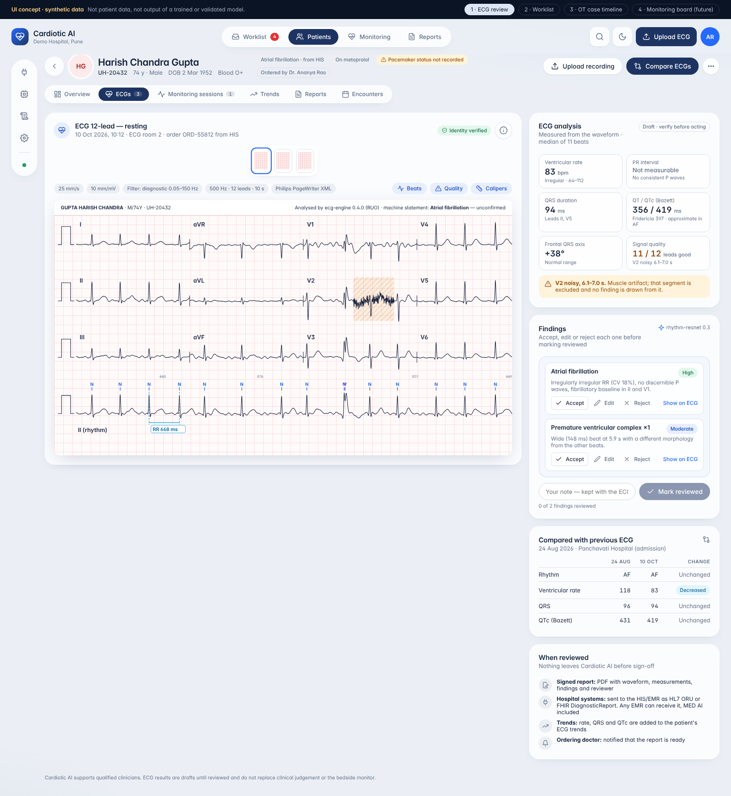
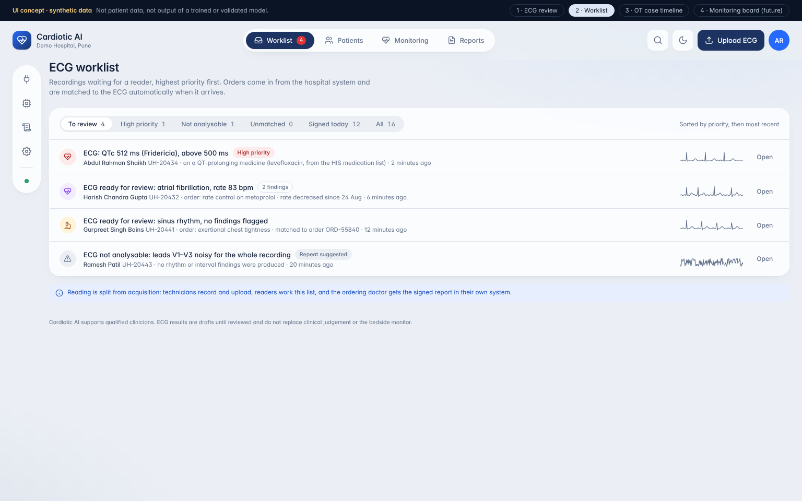
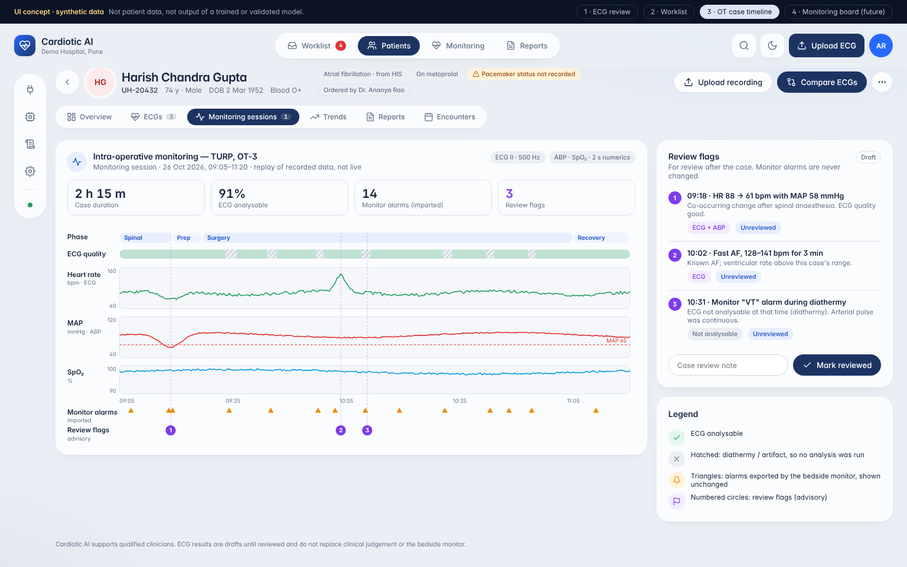
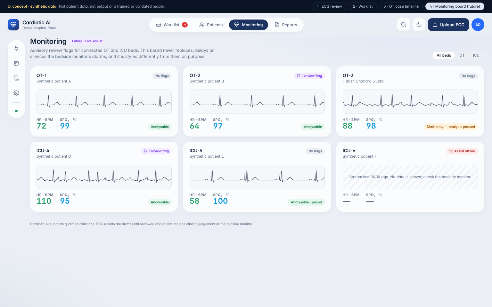
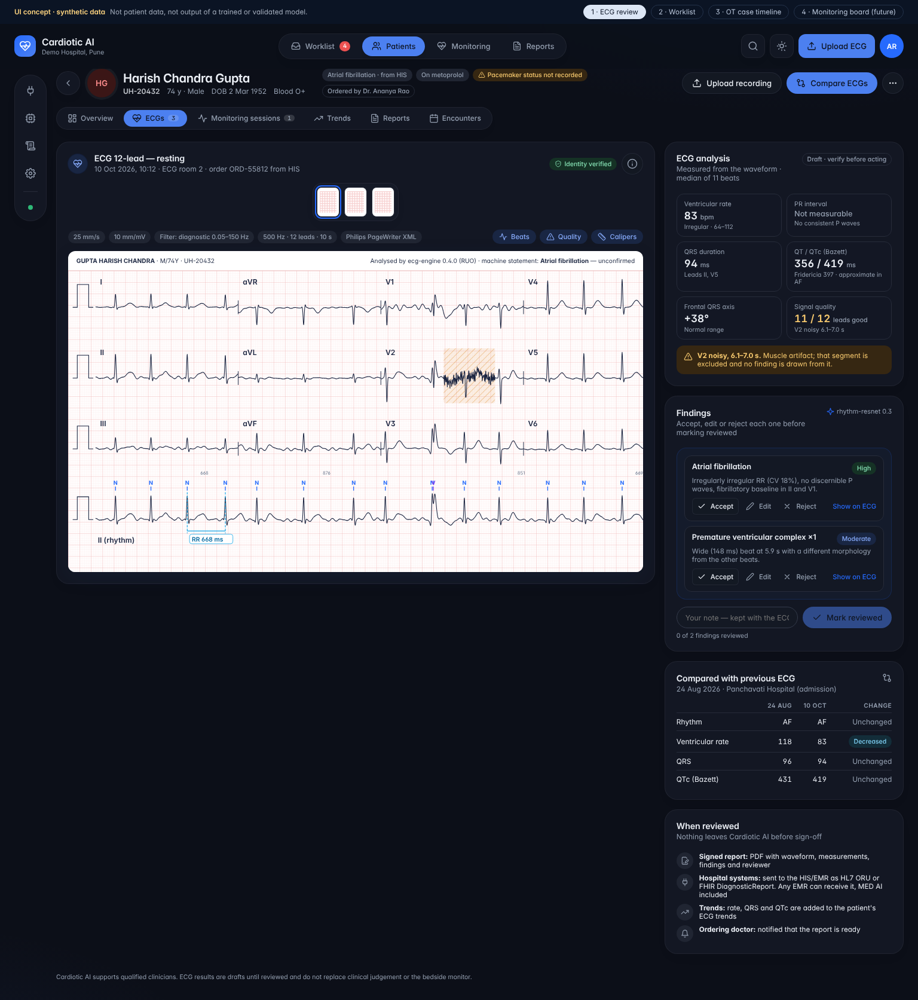

# Cardiotic AI: Product Plan

| | |
|---|---|
| **Document** | Product plan and review of the "AI-Powered ECG Monitoring and Cardiac Risk Detection System" research (Oct 2026) |
| **Status** | Draft v0.3. Leadership decisions of 27 Oct 2026 recorded in section 0; open questions in section 14 |
| **Product** | **Cardiotic AI**: a standalone product, separate from MED AI (GMS Clinical AI). MED AI is the reference for UI design language and for safety patterns only |
| **Scope** | Product definition, regulatory path, data, AI/ML, architecture, UI, roadmap, team, risks |
| **UI concept** | [`ui-concept/index.html`](ui-concept/index.html) (open it in a browser). Screenshots are in [`ui-concept/`](ui-concept/) |

> Nothing in this document is a certified readiness level, a regulatory determination, or a
> validated performance claim. Where a number is a **hypothesis** or **target**, it is
> labelled as one. A regulatory consultant must confirm device classification in each target
> market before anything is submitted.

---

## 0. Decisions (27 Oct 2026)

| Topic | Decision | What it changes |
|---|---|---|
| **Markets** | All three eventually; **India (CDSCO) and USA (FDA) first**, EU (MDR) later | One shared quality system and technical file, two submissions (section 6) |
| **First buyers** | **Hospitals** (ECG reading rooms first) **and medical-equipment manufacturers** (ECG carts, monitors, Holter) | The ECG engine must ship both inside our hospital application and as an embeddable engine for manufacturers (sections 5.1, 9) |
| **Branding** | **"Cardiotic AI" alone** (no parent-company name in the product) | Product name, UI and documents updated; own logo needed; trademark search in India and the USA before launch |
| **Deployment** | **On-premise in the hospital** | Offline install, no internet dependency, CPU-only sizing (measured: section 9.7) |

---

## 1. Verdict on the research

**The research is a good starting point, but it is not yet a product plan.** It gets the
hardest strategic calls right: software first, no hardware; offline before real time; a
signal-quality gate before any AI output; never touching the bedside monitor's alarms. Its key
facts also check out (section 15). What it lacks is what turns a strong prototype into a product a
hospital can buy and a regulator can clear:

| Area | Research says | Assessment | Change needed |
|---|---|---|---|
| Software-first, no hardware | Yes | ✅ Correct | Keep |
| Product A → B → C progression | Yes | ✅ Correct | Keep, add a "silent-mode" step before B shows anything to clinicians |
| Signal-quality gate before AI | Yes | ✅ Correct, and the most important design rule | Keep, and make it a hard architectural gate |
| Don't modify monitor alarms | Yes | ✅ Correct | Keep, written into the intended use |
| Python / FastAPI / React stack | Yes | ✅ Same stack the team already ships in MED AI | Keep. Add ONNX Runtime, PostgreSQL and object storage (section 9) |
| Product name "Cardiac **Risk Detection**" | Yes | ❌ Over-claims | Rename. "Risk prediction" is a prognostic claim with a much higher evidence and regulatory bar |
| Product shape (standalone app vs. embedded) | Not decided | ⚠️ Gap | **Standalone product** with its own repo and release cycle, reusing MED AI's design language and proven safety patterns. It talks to any HIS/EMR (MED AI included) through standards (sections 3.2, 9) |
| Target customer / beachhead | "Hospitals, ICUs, OTs, device makers, research teams" | ⚠️ Too broad | Pick one beachhead (section 5) |
| Intended use statement | Not written | ❌ Gap | Drives classification, validation and labelling, so it is written first (section 4) |
| Regulatory path | "Requires regulatory assessment" | ❌ Too vague | Concrete standards, classes and QMS plan (section 6) |
| Dataset licences | Not checked | ❌ **Commercial blocker** | Some suggested data cannot be used commercially (section 7.2) |
| Industry test standard (ANSI/AAMI EC57) | Not mentioned | ❌ Gap | This is how arrhythmia algorithms are benchmarked. It is required (section 8.6) |
| Most relevant public dataset (PhysioNet/CinC 2015 false-alarm challenge) | Not mentioned | ❌ Gap | Directly matches our alarm-fatigue thesis (section 7.1) |
| Own clinical data + labelling protocol | Not mentioned | ❌ Gap | No clearance is possible without it (section 7.3) |
| Real hospital file formats (DICOM-ECG, HL7 aECG, SCP-ECG, vendor XML) | Only WFDB / CSV / EDF | ⚠️ Gap | Carts and management systems export these (section 9.3) |
| ECGs that arrive as paper scans or photos | Not mentioned | ⚠️ Gap | Common in Indian OPDs and referrals (MED AI's own sample charts hold ECGs as JPGs). Phase 1: display + read the cart-printed values. Digitisation is a later, separately validated feature (sections 7.1, 9.3) |
| 12-lead interval measurements (PR, QRS, QT/QTc, axis) | Not mentioned | ⚠️ Gap | This is what clinicians check first and trust most (section 8.4) |
| Paced rhythms, 3/5-lead OT monitors, electrocautery | Partly | ⚠️ Gap | Specific engineering is needed for each (section 8.2) |
| Patient-level data splits / leakage | Not mentioned | ⚠️ Gap | The most common reason published ECG accuracy fails to reproduce (section 8.6) |
| ECG foundation models (2025–26) | Not mentioned | ⚠️ Gap | Evaluate them as a backbone, with licence checks (section 8.5) |
| Competitors / differentiation | Not mentioned | ❌ Gap | Generic "ECG AI classification" is a crowded market (section 5.2) |
| Cybersecurity, SBOM, PCCP for model updates | Not mentioned | ⚠️ Gap | Required for modern submissions (section 6) |
| Timeline, team, budget, risks | Not mentioned | ❌ Gap | Sections 11–13 |
| GPL-3.0 code (PTB-XL Benchmarking) in the reuse table | Listed as reusable | ⚠️ Licence risk | Use it to study methods only. Never copy its code into the product (section 7.4) |

**Bottom line:** proceed, with the changes above. Build it as **its own product, Cardiotic AI**, in
its own repository. It is a regulated medical device on its own lifecycle, so it must not share
releases with MED AI. It still borrows MED AI's look and feel and its proven patterns: identity
checks, draft-then-review, provenance, audit and local-first deployment. That way users of both
GMS products feel at home and we don't re-learn the same lessons.

---

## 2. What the research gets right (keep it)

1. **Software, not hardware.** Building a patient-connected device adds electrical safety
   (IEC 60601-1), EMC, manufacturing and hardware certification on top of everything else.
   Software that reads data from existing, already-certified monitors and carts is the right
   entry point.
2. **The A → B → C sequence.** Offline analysis (A) gets data pipelines, models, validation
   and the QMS working before we take on real-time integration (B) and multi-parameter
   inference (C).
3. **A signal-quality gate before AI.** In the OT, a large share of the problem *is* artifact:
   diathermy, motion, lead-off. "Uninterpretable segment" must be its own output, not a
   low-confidence rhythm call.
4. **Never silence or replace monitor alarms.** Our product runs *alongside* the certified
   monitor, never instead of it.
5. **Critical functional requirements 1–10.** These match the safety rules MED AI already
   follows (never invent, keep provenance, keep model versions, fail safely). We adopt them as
   written and turn each into a numbered, tested requirement (section 9.6).
6. **The 0.5–40 Hz caution.** Correct. See section 8.3 for the exact filter modes.
7. **Its numbers are accurate** (checked in section 15).

---

## 3. What must change, and why

### 3.1 Rename the product, narrow the claims
"Cardiac **Risk Detection**" implies prognosis: predicting that a patient *will* deteriorate.
That is a separate, much harder claim. It needs outcome-labelled prospective data and pushes
classification up a risk class. Until we have that evidence, the product **detects and
measures what is in the signal**. It does not predict outcomes.

- Product: **Cardiotic AI**, used alone. Run trademark searches in India and the USA before public launch.
- Product A: **ECG Review**. Product B: **Live Assist**. Product C: **Periop Insight**.

### 3.2 A standalone product that shares MED AI's design language
Cardiotic AI is **a separate product**: separate repository, separate releases, separate
regulatory file. Reasons:

- **Regulatory scope.** ECG analysis is a medical device (SaMD). Keeping it apart from MED AI's
  RAG chat, research and LLM features keeps the regulated scope small and auditable.
- **Different buyers and workflows.** ECG reading rooms, tele-ECG services, OT/ICU teams and
  device OEMs. None of them needs a general clinical assistant to buy an ECG product.
- **Independent cadence.** Model updates follow a change-control plan (PCCP), not MED AI's
  release train.

What we **do** carry over from MED AI, deliberately:

| From MED AI | How Cardiotic AI uses it |
|---|---|
| Design language (tokens, glass cards, pill nav, rail, patient header, light/dark theming) | Same look and feel. We copy the token set and UI kit into this repo (not a shared runtime dependency) |
| Identity check + quarantine of wrong-patient documents | Every recording is matched to the patient (name / ID / DOB from file headers) before analysis |
| Draft → clinician review → final | ECG findings are drafts until accepted, edited or rejected. The report is signed |
| "Why this answer" provenance panel | "Why these results": file hash, engine and model versions, filter mode, timings |
| Inbox of things needing a decision | ECG worklist |
| Local-first, on-prem deployment | Default deployment model |
| Audit log, roles, feedback | Same concepts, own implementation |

Integration with MED AI, or any other EMR, goes through **standards** (HL7 v2 ORU, FHIR
DiagnosticReport / Observation, DICOM). MED AI is just one more consumer of signed ECG reports.
The LLM features of MED AI may *summarise or cite* a signed ECG report, but nothing from an LLM
ever enters the ECG measurement or classification path.

### 3.3 Pick a beachhead customer
See section 5. Product A on its own ("upload a file, get a report") mostly serves research teams
unless it plugs into a real workflow: an ECG worklist, a tele-ECG service, or perioperative case
review.

### 3.4 Make licences and data a first-class workstream
Several datasets suggested for this work are **non-commercial** or require attribution or
share-alike terms. A model trained on non-commercial data can contaminate the commercial
product. Every dataset, code dependency and pretrained weight goes through a licence register
(section 7.4) *before* any training run uses it.

### 3.5 Test against the standards the market uses
Arrhythmia and ECG-measurement algorithms are benchmarked with **ANSI/AAMI EC57**, plus
**IEC 60601-2-25 / -2-27 / -2-47** performance clauses depending on the claim. Our
validation reports follow those formats so buyers and regulators can compare us against
predicate devices.

---

## 4. Product definition and intended use

Intended-use statements are **drafts**. Final wording is set with the regulatory consultant,
because the wording itself determines classification.

### Product A: **ECG Review** (first commercial product)
- **Intended use (draft):** Software that analyses previously recorded resting 12-lead and
  multi-lead ECGs, and long single/multi-lead recordings, to measure intervals, assess
  signal quality, detect beats and classify rhythms, and present results to qualified
  healthcare professionals **for review**. Results are not intended to be the sole basis
  for diagnosis or treatment. Not for real-time patient monitoring. Not for paediatric use
  until validated.
- **Users:** cardiologists, physicians, anaesthesiologists, trained ECG technicians.
- **Outputs:** quality per lead and segment, beat annotations, HR/PR/QRS/QT/QTc/axis, rhythm
  statements from a controlled vocabulary, flagged segments, a draft report, then a
  clinician-signed report.

### Product B: **Live Assist** (after A is cleared and validated)
- Streams waveforms from one supported monitor vendor and shows **advisory review flags** on
  a separate screen. It never suppresses, delays or overrides monitor alarms.
- Runs first in **silent mode** (computing, not displaying) during a prospective study.

### Product C: **Periop Insight** (long-term differentiator)
- Time-aligns ECG with ABP/NIBP, SpO₂/PPG, EtCO₂ and drug or event markers for intra-operative
  case review. It flags **co-occurring changes** (for example, a rhythm change coincident with a MAP drop)
  for review. It never infers "patient is unstable" without a validated clinical definition.

### Out of scope (all products, until separately validated)
Outcome or risk prediction, automatic treatment advice, alarm suppression, paediatric and
neonatal use, home-use or consumer devices, and diagnosis from photos of paper ECGs.

---

## 5. Market and commercial strategy

### 5.1 Beachhead (decided: hospitals + equipment manufacturers)

| Option | Buyer | Why attractive | Main risk |
|---|---|---|---|
| **1. Hospital ECG review & reporting** (12-lead + rhythm strips; worklist, measurements, draft report, sign-off) | Hospital cardiology / diagnostics, multi-site hospital groups, tele-ECG providers | Clear workflow, clear buyer, fastest regulatory path, plugs into the HIS via orders and reports | Crowded market, so we need clear differentiation |
| **2. Perioperative case review** (post-op ECG + vitals review, artifact-aware) | Anaesthesia departments, OT quality committees, clinical engineering | Distinctive (VitalDB-style data), little direct competition, natural path to C | Smaller budget line, and value must be shown with data |
| **3. OEM algorithm licensing** | Monitor / ECG-cart manufacturers | Large volume per deal | Long sales cycles; OEMs demand EC57 / IEC evidence and a QMS first |

**Decision (27 Oct 2026): Options 1 and 3 together**, Option 2 as a later pilot. Both buyers use the
**same ECG engine**; what differs is how it is delivered:

| | Hospitals (Option 1) | Equipment manufacturers (Option 3) |
|---|---|---|
| What they buy | The Cardiotic AI application on their own server: worklist, review, signed reports, HIS link | The **engine**: an embeddable, offline library their ECG cart, monitor or Holter software calls |
| What they need from us | Workflow, integration (HL7/FHIR/DICOM), on-prem install and support, local clearance | Stable API, deterministic outputs, **EC57 / IEC 60601-2-25 / -27 / -47 test reports**, IEC 62304 software documentation they can put in their own submission |
| Commercial model | Annual licence per site | Per-unit royalty or annual platform fee |
| First AI capability that matters | 12-lead measurements and statements, rhythm review | Same 12-lead set for carts; arrhythmia/beat analysis for monitors and Holter |

Consequence for engineering: the regulated `ecg-engine` is packaged as its own component from
day one (exported models + versioned API), and **12-lead measurements and statements (model M4)
move to the top of the AI roadmap**, because both buyers need them.

### 5.2 Competitive landscape (to be expanded in discovery)
- **Monitor / cart incumbents with built-in algorithms:** Philips, GE HealthCare, Mindray,
  Nihon Kohden, Schiller, and BPL in India. Their in-device interpretation is the baseline we must beat.
- **ECG AI software companies:** Tricog (India, tele-ECG), Anumana, Idoven, AliveCor,
  Cardiologs (Philips), AccurKardia, HeartBeam, and others.
- **Our differentiation hypotheses** (to test in discovery interviews, not assumed):
  1. **Local-first / on-prem**: ECGs and patient data never leave the hospital, as MED AI
     already does today.
  2. **Vendor-neutral**: one review workspace across GE, Philips and Mindray exports.
  3. **Artifact-aware**: explicit, traceable signal-quality outputs, built for OT/ICU-grade
     noise rather than clean 10-second ECGs.
  4. **Drops into existing systems**: orders in from the HIS, signed reports back out (HL7/FHIR).
     It works next to MED AI or any other EMR, and doesn't replace them.
  5. **Perioperative multi-signal review** (Product C), which few products address.

### 5.3 Business model (hypotheses)
- On-prem annual licence per site, tiered by ECG volume or beds; implementation and integration fees.
- A Research-Use-Only (RUO) licence for academic and clinical-research groups, available early
  (revenue plus data partnerships, no clinical claims).
- OEM per-unit royalty (later).

---

## 6. Regulatory and quality strategy

> Classes below are **working assumptions** from public guidance and predicate searches.
> A consultant confirms them in Phase 0. Decision (27 Oct 2026): **India and USA first, EU later.**

| Market | Likely pathway for Product A | Notes |
|---|---|---|
| **India (CDSCO)** | SaMD under Medical Devices Rules 2017 (IMDRF-aligned A–D). Diagnosis-support ECG analysis is likely **Class B or C** | Request formal classification clarification from CDSCO early. DPDP Act 2023 governs patient data |
| **USA (FDA)** | **510(k)**. Predicates commonly use product code **DQK** (21 CFR 870.1425, programmable diagnostic computer). Real-time arrhythmia detection (Product B) maps to **DSI** (21 CFR 870.1025, arrhythmia detector & alarm, Class II special controls) | PCCP (predetermined change control plan) to allow planned model updates. Section 524B cybersecurity (SBOM, threat model). QMSR (ISO 13485-aligned) in force since Feb 2026 |
| **EU (MDR)** | Rule 11 SaMD, likely **Class IIa+**, needs a Notified Body | EU AI Act: AI in MDR devices is "high-risk". Those obligations apply from Aug 2027 |

**Standards and processes we adopt from day 1** (cheap now, very expensive to retrofit):

| Standard | What it means for us |
|---|---|
| ISO 13485 | Quality management system: document control, design controls, CAPA, supplier control |
| IEC 62304 | Software lifecycle; `ecg-engine` likely safety Class B (confirm via risk analysis) |
| ISO 14971 | Risk management file (hazards, e.g. missed VT, false AF, wrong-patient display) |
| IEC 62366-1 | Usability engineering: formative studies, then a summative validation with real clinicians |
| IEC 81001-5-1 | Secure health-software lifecycle |
| ANSI/AAMI EC57 | Rhythm / ST algorithm test and reporting method |
| IEC 60601-2-25 / -2-27 / -2-47 | Performance clauses for 12-lead interpretation / monitoring / ambulatory claims |
| IEC 60601-1-8 | Alarm-system principles (relevant to how Product B displays advisory flags) |
| HL7 FHIR, HL7 v2, DICOM | Interoperability |

### 6.1 One quality system, two submissions
Build once, use for both: the ISO 13485 QMS (accepted by FDA's QMSR and aligned with CDSCO's
Medical Devices Rules 2017 QMS requirements), IEC 62304 software file, ISO 14971 risk file (with
AAMI CR34971 for AI), IEC 62366-1 usability file, IEC 81001-5-1 security file with SBOM,
EC57 / IEC 60601-2-25 performance reports, the clinical validation report, and a change-control
plan for model updates. Each market then adds its own forms and local data.

### 6.2 India (CDSCO) track
1. **Classification:** confirm the class (likely B or C) with the consultant; request CDSCO clarification if unclear.
2. **Test licence:** Form **MD-12** application → **MD-13** licence, to manufacture the software for clinical
   investigation, testing and evaluation at the Indian partner hospital.
3. **Indian clinical performance evaluation:** at least one Indian hospital, ethics-committee approval, Indian
   patients and the ECG machines used locally. Whether formal clinical-investigation permission is needed
   depends on class and novelty (consultant).
4. **Manufacturing licence** on the SUGAM portal: Class A/B — Form **MD-3** → licence **MD-5** (State Licensing
   Authority); Class C/D — Form **MD-7** → licence **MD-9** (Central Licensing Authority). QMS audit.
5. **Post-market:** vigilance and complaint handling. Patient data: DPDP Act 2023; on-prem deployment keeps
   data inside the hospital.

### 6.3 USA (FDA) track
1. **Predicate:** ECG analysis software under product code **DQK** (21 CFR 870.1425) for Product A; **DSI**
   (21 CFR 870.1025) later for real-time arrhythmia alarms (Product B).
2. **Pre-Submission (Q-Sub) meeting early:** agree the validation plan — datasets, endpoints, subgroup
   analyses, and the change-control plan (PCCP) for model updates.
3. **Validation:** EC57 testing on the recognised databases (MIT-BIH, AHA, NST), IEC 60601-2-25 measurement
   accuracy for 12-lead claims, and clinical data **representative of the US population** (multi-site). Indian
   data alone will not be enough for FDA; a US data source is needed (section 14).
4. **510(k) via eSTAR:** software documentation, AI-specific content per FDA's AI-enabled device software
   guidance (draft, Jan 2025), Section 524B cybersecurity (SBOM, threat model, vulnerability handling), PCCP.
5. **Registration:** US agent, establishment registration and device listing; QMSR compliance.

### 6.4 Sequencing
Research-use build to partners → India test licence and Indian validation, with an FDA Pre-Sub in parallel →
India manufacturing licence → FDA 510(k) → post-market surveillance in both → EU (MDR Notified Body, Class
IIa likely, plus EU AI Act obligations) reusing the same core file. Product B starts later with a
silent-mode prospective study.

---

## 7. Data strategy

### 7.1 Public datasets (expanded from the research)

| Dataset | Content | Use | Licence (checked Oct 2026, **re-check per version**) | Commercial training? |
|---|---|---|---|---|
| MIT-BIH Arrhythmia | 48 × 30 min, 2-lead, 360 Hz, ~110k beat labels | QRS detection, beat classes, EC57 | ODC-By 1.0 | ✅ with attribution |
| MIT-BIH Noise Stress Test | Calibrated noise added to clean ECG | **Signal-quality robustness, EC57 noise testing** | ODC-By 1.0 | ✅ |
| MIT-BIH AF / Long-Term AF | Long AF recordings | AF episode detection | ODC-By 1.0 | ✅ |
| PTB-XL 1.0.3 | 21,799 × 10 s 12-lead, 18,869 patients | 12-lead diagnostic statements | CC BY 4.0 | ✅ with attribution |
| Chapman–Shaoxing (figshare 4560497) | 10,646 × 10 s 12-lead, 500 Hz, China, GE MUSE, with MUSE measurements | **External test** of statements and measurements (never trained on) | CC0 | ✅ |
| Chapman–Shaoxing–Ningbo (PhysioNet `ecg-arrhythmia` 1.0.0) | 45,152 × 10 s 12-lead (includes the 10,646 above) | Training data from a second country (Ningbo part only) | CC BY 4.0 | ✅ with attribution |
| PTB-XL+ 1.0.1 | Measurements of the same ECGs by GE 12SL and Uni-G (intervals, axes, amplitudes) | **Reference for our interval measurements** (not ground truth) | CC BY 4.0 | ✅ with attribution |
| **PhysioNet/CinC 2015** | ~1,250 ICU alarms (asystole, brady, tachy, VT, VF/flutter), ECG + ABP/PPG | **False-alarm reduction: our exact thesis** | ODC-By 1.0 | ✅ |
| PhysioNet/CinC 2017 | ~8.5k single-lead AF recordings | AF vs other vs noise | Verify | Verify |
| PhysioNet/CinC 2020/2021 | ~88k 12-lead from many countries | Multi-source generalisation | Mixed per source, so verify each | Verify per source |
| CODE-15% | 345,779 12-lead exams, 233,770 patients | Large-scale 12-lead pretraining | Listed as CC BY 4.0 (confirm on Zenodo) | Likely ✅ |
| MIMIC-IV-ECG | ~800k 12-lead, ~160k patients, linked reports | Pretraining, report-linked labels | ODbL 1.0 (open access) | ✅ with ODbL share-alike on *database* derivatives. Legal review required |
| VitalDB | 6,388 surgical cases, waveforms 62.5–500 Hz | **OT signal quality, Product C research** | CC BY 4.0 | ✅ with attribution |
| Icentia11k | 11k patients, single-lead long-term, 250 Hz | Representation learning | **CC BY-NC-SA 4.0** | ❌ **Non-commercial: research only, never in product weights** |
| AHA ECG database | Ventricular arrhythmia reference | EC57 testing | Paid licence (ECRI) | Buy for V&V |
| CSE database | 12-lead measurement reference | IEC 60601-2-25 measurement accuracy | Restricted / paid | Acquire for V&V |

### 7.2 Licence rule
A model whose weights touched non-commercial data **cannot ship**. Each training run records
the dataset IDs and licence IDs it used, in the model card and the model registry (section 9.4).
CI blocks promoting a model that has a non-commercial dataset in its lineage.

### 7.3 Our own clinical data (required for clearance)
Public data alone will not clear a regulator or convince a hospital. Plan:
1. **Hospital partner(s)**, ideally two sites with different monitor vendors. Ethics committee
   approval, a data-sharing agreement, and de-identification **on-site** (MED AI already runs
   locally, which helps).
2. **Retrospective set:** 12-lead ECGs from the ECG management system (MUSE / IntelliSpace /
   vendor XML), with the existing cardiologist over-read as a weak label.
3. **Reference labels:** a stratified subset labelled independently by ≥2 cardiologists, with
   adjudication by a third. Track inter-rater agreement (Cohen's / Fleiss' κ).
4. **Perioperative set:** monitor exports or Vital Recorder captures with ECG + ABP/SpO₂ +
   electrosurgical-unit activity markers, labelled for quality and events by anaesthesiology.
5. **Demographic coverage:** age, sex, BMI and paced patients, plus (for India) population
   representativeness, which most public datasets lack.
6. **Locked test set:** created once, stored separately, never used for training or
   tuning. Only the V&V team can access it.

### 7.4 Code and weights licence register
| Item | Licence | Policy |
|---|---|---|
| wfdb-python, NeuroKit2, torch_ecg, vitalutils, BioSPPy | MIT / BSD-3 | ✅ May be used as dependencies. Keep notices in `THIRD_PARTY_NOTICES.md`. Pin versions; SOUP list under IEC 62304 |
| automatic-ecg-diagnosis, ecg (amiri-amin), PTB-XL classification (AndrewLucenko) | MIT | ✅ Study and adapt with notice. Their **weights** need separate checks (training-data lineage) |
| ecg_ptbxl_benchmarking | **GPL-3.0** | ⚠️ Read and reproduce methods only. **No code copied** into the proprietary product |
| Synthea | Apache-2.0 | ✅ Synthetic test patients |
| Foundation-model weights (e.g. ECG-FM, ECGFounder) | Varies | Check the weight licence **and** the pretraining data licences before any use |

---

## 8. Signal processing and AI design

### 8.1 Pipeline (every stage is versioned and every output traceable to sample indices)

```text
Ingest → Standardise → Quality gate → Fiducials → Measurements → Classifiers → Rules/fusion → Draft report → Clinician review → Final report
            │              │                                                                                    │
            │              └── "Uninterpretable" output exits here; nothing downstream runs on that segment     │
            └── original samples stored unchanged (hash recorded)                                    signed + audited
```

### 8.2 OT/ICU-specific engineering the research under-specifies
- **Lead configuration:** OT monitors are usually 3/5-lead (often only II, sometimes V5),
  not 12-lead. Models are trained **per lead configuration**, and a 12-lead model is never
  applied to a 3-lead input.
- **Pacemaker pulses:** detect pace spikes, or use the monitor's pace flag where available.
  Paced beats are a separate class. Undetected pacing is a classic source of false QRS
  detection.
- **Electrocautery / diathermy:** detect broadband high-frequency energy and saturation, and
  mark the segment *uninterpretable*. Where available, use the electrosurgical-unit activity
  signal as ground truth.
- **Lead-off, clipping, flat-line, missing samples:** explicit states, never
  silently interpolated.
- **Sample-rate harmonisation:** resample with anti-aliasing to each model's native rate,
  and keep the original.

### 8.3 Filter modes (never one filter for everything)
| Mode | Band | Used for |
|---|---|---|
| Diagnostic | 0.05–150 Hz (per IEC 60601-2-25) | 12-lead morphology, ST, intervals |
| Monitoring | ~0.5–40 Hz | Rhythm and QRS detection in noisy monitoring data |
| Notch | 50 Hz (India/EU) or 60 Hz (US), adaptive | Power-line interference, only when detected |

The UI always shows which mode a displayed waveform uses.

### 8.4 Measurements (high value, high trust)
HR (median RR over a window, from validated beats only), PR, QRS duration, QT, QTc (Bazett **and**
Fridericia, labelled), frontal axis, ST deviation at J+60/80 ms (Product B/C). Delineation
starts with NeuroKit2's methods and is benchmarked against CSE and PTB-XL+ style references.
Clinicians trust measurements they can verify with calipers in the UI, so calipers are part of
the MVP.

### 8.5 Model plan
1. **Classical baseline:** Pan-Tompkins or NeuroKit2 QRS detection + RR / morphology features +
   gradient-boosted trees. This is the reference that every deep model must beat, and the
   explainable fallback.
2. **Signal-quality model:** a small 1D-CNN per lead and window (good / noisy / uninterpretable), trained on
   NST-DB plus labelled VitalDB and partner data. **Ships first**, since every other output depends on it.
3. **Rhythm / beat model:** a 1D ResNet (as in the research), trained per lead configuration with
   patient-level splits.
4. **12-lead statement model:** multi-label 1D ResNet. Separately, evaluate fine-tuning an
   **ECG foundation model** (e.g. ECG-FM, published 2025 with open weights) as the
   backbone. Adopt it only if it beats the ResNet on our locked test set **and** its licence
   lineage is clean.
5. **Calibration and uncertainty:** temperature scaling on a held-out calibration set,
   out-of-distribution detection, and abstention ("insufficient evidence") when either is out of range.
6. **Deployment:** export to **ONNX**, pin ONNX Runtime, run deterministic CPU inference (GPU
   optional). The engine records `model_id`, `model_version`, the weights hash and the
   pipeline version on every output.

**How confidence appears in the UI:** following MED AI's existing rule (no "AI confidence 93%"
unless scientifically calibrated), findings show a **category** (`High / Moderate / Low`)
derived from calibrated probability bins validated on the locked test set. The calibrated
probability itself appears only in the provenance drawer, and only after calibration
validation passes.

### 8.6 Evaluation protocol
- **Splits:** strictly patient-level. MIT-BIH uses the inter-patient DS1/DS2 split (de Chazal),
  never random beat splits. PTB-XL uses the official stratified folds.
- **Metrics:** EC57-style QRS Se / +P; per-class beat and rhythm Se / +P / F1; AF episode and
  duration Se / +P; AUROC / AUPRC for multi-label statements; calibration (ECE, reliability
  plots); measurement error (mean ± SD vs reference, against IEC 60601-2-25 tolerances).
- **Alarm-style evaluation (Product B):** CinC 2015 scoring, which weights missed true alarms
  5× false alarms. Target: **zero true-alarm misses** at the operating point, then maximise
  false-flag reduction.
- **Subgroups:** age, sex, paced, BMI, recording device, site. Performance must hold in every subgroup.
- **Acceptance targets** are set in Phase 0 by the clinical lead from predicate-device
  performance. They are not invented here.

---

## 9. Architecture

### 9.1 Shape

```text
 ECG carts / ECG mgmt systems        Hospital systems (HIS / EMR, e.g. MED AI)
 (DICOM-ECG, HL7 aECG, SCP-ECG,        ▲ signed reports: HL7 ORU / FHIR DiagnosticReport
  GE/Philips XML, EDF, WFDB, scans)    │ orders + patients in: HL7 ORM / ADT, FHIR ServiceRequest
        │                              │
        ▼                       ┌──────┴──────────────────────────────────────────────┐
 ┌──────────────┐  raw files    │ api (FastAPI): auth & roles · patients · worklist ·  │
 │ ingest       │──────────────▶│ recordings · reviews · reports · audit · integrations│◀── web (React, shared design system)
 │ parsers,     │  standardised └──────┬───────────────────────────────▲──────────────┘     REST + WebSocket
 │ identity     │  ECGRecord           │ jobs (queue)                  │ results (append-only)
 │ check        │               ┌──────▼────────────────┐       ┌──────┴──────────────┐
 └──────┬───────┘               │ ecg-engine (REGULATED)│──────▶│ PostgreSQL          │
        │                       │ quality · fiducials · │       │ (+ TimescaleDB)     │
        │                       │ measurements · models │       └─────────────────────┘
        │                       │ ONNX Runtime, pinned  │       ┌─────────────────────┐
        └── originals (hash) ──────────────────────────────────▶│ Object store (MinIO)│
                                └──── model registry ──────────▶│ raw + std waveforms │
                                                                └─────────────────────┘
 Product B: monitor gateway (one vendor first) ─▶ stream bus (NATS / Redis Streams) ─▶ ecg-engine (streaming mode)
```

- **`ecg-engine`** is the regulated software item (IEC 62304). It is a pure function of
  (recording, engine version, model versions): deterministic, no network, no LLM.
- **`api`, `web`, `ingest`** are the application around it. They store, display, route and audit
  engine outputs, and never alter them.
- **`ml/`** (training, experiments, notebooks) lives in the repo but **ships nothing**. Only
  exported, registered ONNX models reach the engine.

### 9.2 Proposed repository layout

```text
cardiotic-ai/
  apps/web/            React + Vite + Tailwind + Radix, design tokens (copied from MED AI's UI kit)
  apps/api/            FastAPI: auth, patients, worklist, recordings, reviews, reports, audit, integrations
  services/ingest/     format parsers, identity check, standardisation (ECGRecord)
  services/engine/     ecg-engine: quality, delineation, measurements, classifiers (regulated)
  ml/                  training pipelines, dataset cards, experiment tracking (not shipped)
  integrations/        HL7 v2, FHIR, DICOM; later monitor gateways
  regulatory/          requirements, risk file, traceability matrix, SOUP list, V&V reports
  infra/               docker compose / helm, install qualification checklists
  docs/                this plan, UI concept, architecture decisions (ADRs)
```

### 9.3 Input formats (priority order)
1. **DICOM ECG waveform** and **HL7 aECG (FDA XML)**: hospital standards.
2. **GE MUSE XML, Philips XML (Sierra / IntelliSpace / PageWriter)**: the most common real exports.
3. **SCP-ECG (EN 1064 / ISO 11073-91064)**, **EDF/EDF+**, **ISHNE** (Holter).
4. **WFDB**: public datasets and research.
5. **VitalDB `.vital` / Vital Recorder**: perioperative research and replay.
6. **Scans / photos / PDF printouts of paper ECGs.** Phase 1: store and display them, and read the
   values *printed by the ECG machine* (rate, intervals, machine statement), labelled as such.
   No AI interpretation of images until a digitisation model is separately validated (the
   PhysioNet 2024 Challenge on ECG image digitisation is the reference benchmark).
7. CSV: development only, never a supported clinical input.

Every parser rejects input whose sampling rate, units, lead set, duration or patient identity
cannot be established.

### 9.4 Data model (core tables)
`patients` (local, or mirrored from HIS via ADT/FHIR) · `orders` · `ecg_recordings` (patient,
order, source device and format, leads, fs, duration, file hash, identity status) ·
`ecg_analysis_runs` (engine version, model IDs and hashes, filter mode, status, timings) ·
`ecg_quality_segments` · `ecg_beats` · `ecg_measurements` · `ecg_findings` (controlled
vocabulary code, onset/offset sample, category, evidence segment IDs) · `ecg_reviews` (reviewer,
accept / edit / reject per finding, note, timestamp) · `ecg_reports` (draft → signed, immutable
once signed, amendments versioned) · `monitoring_sessions` · `model_registry` (model card,
dataset lineage, licence IDs, validation report link) · `audit_log`.

Engine outputs are append-only. A clinician edit creates a review record and never overwrites the
algorithm's output.

### 9.5 Product B real-time notes (later)
- Latency budget (hypothesis to validate): ≤ 5 s from sample to advisory flag. This is a
  review aid, not an alarm.
- Watchdog and heartbeat: if the stream or engine stalls, the UI shows **"Assist offline"**
  within seconds. It never shows stale data as live.
- WebGL / canvas waveform rendering (SVG does not scale to multi-bed 500 Hz streams).

### 9.7 On-premise deployment (decided)
- **Measured** with the research pipeline, **one CPU core, no GPU** (MIT-BIH and AF Database recordings):
  10 s ECG strip **23 ms**; 30-min Holter **3.3 s**; 10-hour Holter **33 s**, **1.3 GB** peak memory
  (after batching model calls; it was 5 GB before). The 12-lead model (M4) is not built yet and will add cost,
  so re-measure then.
- **Implication (estimate):** a single CPU-only hospital server (for example 8 cores, 32 GB RAM) has ample
  capacity for a hospital's daily ECG and Holter volume; no GPU purchase is needed.
- **Packaging:** Docker Compose bundle for a Linux server, installable **fully offline**; local PostgreSQL and
  object storage; offline licence file; backups; health page; role-based access and audit.
- **Integration inside the hospital network only:** HL7 v2 / FHIR to the HIS, DICOM and vendor exports from ECG
  management systems. No patient data leaves the hospital.
- **Updates:** signed release packages, installed in a window the hospital chooses, under the change-control
  plan; every model change is traceable to its validation report.

### 9.6 Engineering practices from day 1
- Requirements carry IDs (e.g. `REQ-QUAL-003`). Tests reference them, and CI produces the
  traceability matrix.
- SOUP / third-party list and SBOM generated in CI. Dependency versions pinned.
- Protected `main`, reviewed PRs, signed release tags. Every release has release notes and a V&V record.
- The locked clinical test set is never in the repo. It sits in a separate, access-controlled store.

## 10. UI plan: shared design language, ECG-specific workflow

Cardiotic AI uses **the same design language as MED AI's current UI**: colour tokens, glass
cards, top pill navigation with an icon rail, the patient header with context chips, tab pills,
badges, light/dark themes and density settings. The information architecture is its own, built
around ECG reading.

**See the concept:** open [`ui-concept/index.html`](ui-concept/index.html) in a browser. Use the bar at
the top to switch screens and the moon icon to switch theme.

| Screen | Product | Screenshot |
|---|---|---|
| **1. ECG review**: ECG paper (25 mm/s, 10 mm/mV), beat labels, calipers, quality overlay, measurements, findings with accept/edit/reject, comparison with the previous ECG, "Why these results" | A |  |
| **2. ECG worklist**: queue for readers, priority first; orders matched automatically | A |  |
| **3. Monitoring session (OT case timeline)**: HR / MAP / SpO₂ aligned, diathermy segments, imported monitor alarms vs review flags | A → C |  |
| **4. Monitoring board**: live advisory board with an explicit "Assist offline" state | B (future) |  |
| Dark theme | |  |

### 10.1 Information architecture
- **Top nav:** Worklist · Patients · Monitoring (future, behind a feature flag) · Reports.
- **Rail:** Devices & integrations (carts, monitors, HIS links and their health) · Model registry ·
  Audit log · Settings.
- **Patient tabs:** Overview · ECGs · Monitoring sessions · Trends · Reports · Encounters.
- **Patient header chips** show what changes how an ECG is read: known rhythm (from HIS),
  rate-control drugs, **pacemaker status** (flagged when unknown), and the ordering doctor.

### 10.2 UI safety rules (non-negotiable, testable)
1. **Signal-quality problems look different from findings.** Quality issues are amber or grey
   *notices*. Findings are listed separately. A segment marked uninterpretable shows hatched
   on the waveform and carries **no** finding.
2. **Algorithm vs clinician is always visible.** Every value is labelled as measured by the
   algorithm, edited by a named reviewer, or accepted by one. Reports stay **Draft** until reviewed.
3. **No colour-only meaning.** Every state has a text label and an icon (accessibility, IEC 62366).
4. **Display mode is always shown:** speed, gain, filter mode, lead set, sampling rate, source format.
5. **Traceability:** clicking a finding jumps to its exact segment on the waveform.
6. **Provenance:** "Why these results" shows the file hash, engine and model versions, and the analysis time.
7. **Failure states are explicit:** "Model unavailable, measurements only", "Unsupported
   lead configuration", "Not analysable", "Assist offline". The UI never shows a blank or stale value as if it were valid.
8. **The monitoring board never mimics a bedside alarm** (no flashing red full-screen, no tones).
   Flags are advisory, prioritised for review, and visually distinct from monitor alarms.
9. **Comparison language is neutral:** *increased / decreased / unchanged*, never *improved /
   worsened* (a MED AI rule worth keeping).
10. **Synthetic or demo data** is always labelled as such.

### 10.3 Validation of the UI
Formative usability sessions with 5–8 clinicians per role (cardiology, anaesthesia, ECG
technician), then a summative IEC 62366 study before submission. The concept HTML is the starting
point for the first formative round.

## 11. Roadmap with gates

Durations are **planning estimates** for the team in section 12. They are re-baselined after Phase 0.

| Phase | Months | Key deliverables | Exit gate |
|---|---|---|---|
| **0. Discovery & foundations** | 0–2 | 12–15 customer interviews (cardiology, anaesthesia, biomed, IT); beachhead decision; draft intended use; regulatory consultant + classification opinion; hospital partner + ethics submission; licence register; QMS skeleton (ISO 13485 / IEC 62304 / ISO 14971 SOPs) | Leadership sign-off on beachhead, intended use, markets, budget |
| **1. Platform + Engine R1 (RUO)** | 2–6 | Repo, CI, requirement IDs, SBOM; app basics (auth/roles, patients, worklist, audit) using MED AI's patterns and design system; ingest (WFDB, EDF, DICOM-ECG, HL7 aECG, GE/Philips XML; scans displayed with printed values); quality gate; QRS detection with an EC57 report on MIT-BIH/NST-DB; measurements; baseline + ResNet rhythm models; ECG review + worklist UI; HL7/FHIR report export | EC57 report reviewed by the clinical lead; RUO build installable at the partner site |
| **2. Product A clinical-grade** | 6–12 | Design controls and full traceability; retrospective validation on partner data with cardiologist-adjudicated labels; usability (formative → summative); cybersecurity file and SBOM; technical file; **Periop case-review pilot** (VitalDB + partner OT data) | Validation meets the pre-set acceptance targets; submission filed (CDSCO first, if India is chosen) |
| **3. Live Assist pilot (B)** | 12–20 | Monitor gateway for one vendor; streaming engine; **silent-mode prospective study** (engine runs, nothing shown); false-flag and true-miss analysis | Zero true-event misses at the operating point in silent mode → ethics approval to display flags |
| **4. Periop Insight (C) & scale** | 20+ | Multi-signal correlation models; a second monitor vendor; FDA/EU pathways; PCCP; post-market surveillance | Clinical evidence for each new claim |

**Discipline:** each phase has a demo of real functionality. That follows MED AI's existing
"no dummy buttons" rule, so unfinished routes show "Not yet available" honestly.

---

## 12. Team (minimum viable)

| Role | FTE | Notes |
|---|---|---|
| Product manager (clinical domain) | 1 | Owns intended use, beachhead and roadmap |
| DSP / ML engineers | 2 | Signal quality, delineation, models, evaluation |
| Backend engineers | 2 | App platform (auth, patients, worklist, audit), ingest parsers, engine service, HL7/FHIR integration |
| Frontend engineer | 1 | Cardiotic AI web app, waveform rendering |
| QA / V&V engineer | 1 | Test protocols, EC57 / IEC reports, traceability |
| Quality & regulatory lead | 1 (or consultant + 0.5 internal) | QMS, technical file, submissions |
| Clinical leads (advisory) | Cardiologist + anaesthesiologist, ~0.2 each | Labels, acceptance targets, usability |
| Clinical / biomedical engineer | 0.5 | Monitor integration, hospital IT |
| Annotators | Contract cardiologists / technicians | Paid per labelled record, with adjudication |

**Non-salary budget lines:** regulatory consultant, ISO 13485 certification audit,
notified-body / FDA fees (per market), AHA/CSE databases, cardiologist annotation, hospital
partnership costs, pen-testing, liability insurance, GPU training compute.

---

## 13. Top risks

| # | Risk | Impact | Mitigation |
|---|---|---|---|
| 1 | Model does well on public data, poorly on partner hospital data | Fails validation | Partner data from Phase 1; per-site evaluation; per-lead-configuration models |
| 2 | Non-commercial data or weights enter the product | Legal / product recall | Licence register + CI lineage check (section 7.2) |
| 3 | Missed true arrhythmia (false negative) | Patient harm | ISO 14971 analysis; FN-weighted operating points; advisory-only intended use; silent-mode study |
| 4 | Over-claiming in marketing ("detects risk", "diagnoses") | Regulatory action | Claims matrix reviewed by regulatory before any material goes out |
| 5 | Monitor vendors do not expose raw waveforms | Product B blocked | Verify per model in Phase 0; start with exports and Vital Recorder; partner with one vendor |
| 6 | Crowded market, no differentiation | Weak sales | Discovery interviews; local-first + vendor-neutral + periop focus |
| 7 | Annotation cost and cardiologist availability | Delays | Active learning; weak labels from existing over-reads; adjudicate only a stratified subset |
| 8 | Wrong-patient display / identity mismatch | Patient harm | Identity check + quarantine (pattern proven in MED AI); patient banner always visible; DICOM/HL7 identifiers |
| 11 | Standalone product means rebuilding platform basics | 2–3 months of extra effort | Port MED AI's auth / audit / identity-check patterns and UI kit early; keep app scope minimal (worklist, patients, reports) |
| 9 | Cybersecurity incident on hospital network | Harm + liability | IEC 81001-5-1, SBOM, pen-test, on-prem by default, least privilege |
| 10 | QMS started too late | Months of rework | QMS skeleton in Phase 0, not after the prototype |

---

## 14. Open questions

Decided on 27 Oct 2026 (section 0): markets (India + USA first), buyers (hospitals + equipment
manufacturers), branding ("Cardiotic AI" alone), deployment (on-premise). Still open:

3. **Hospital partner:** do we have one (or two)? Which **monitors and ECG carts** do they use
   (Philips / GE / Mindray / Nihon Kohden / Schiller / BPL)? Can they export raw waveforms?
5. **QMS status:** does GMS already hold ISO 13485 or have any medical-device QMS? If not, do we
   hire a regulatory lead or use a consultant?
7. **Team and budget:** is the team in section 12 realistic? What timeline does leadership expect?
8. **RUO first:** may we release a Research-Use-Only build to research partners in Phase 1?
9. **US clinical data source (new):** FDA will expect US-representative validation data. Options: a US
   hospital partner, a contract research organisation, or licensed US ECG datasets.
10. **Target manufacturers (new):** which ECG-cart, monitor or Holter makers should we approach first
    (Indian makers such as BPL, or global ones)? This decides the engine's first API and test reports.

---

## 15. Fact-check of the research

| Claim in research | Check | Source |
|---|---|---|
| VitalDB: 6,388 surgical cases, waveforms up to 500 Hz | ✅ (62.5–500 Hz). Licence **CC BY 4.0** | [PhysioNet VitalDB](https://physionet.org/content/vitaldb/1.0.0/) |
| PTB-XL 1.0.3: 21,799 records, 18,869 patients, 10 s, 100/500 Hz | ✅ | [PhysioNet PTB-XL](https://physionet.org/content/ptb-xl/1.0.3/) |
| MIT-BIH: 48 × ~30 min, 47 subjects, 360 Hz, ~110k annotations | ✅ | [PhysioNet MIT-BIH](https://physionet.org/content/mitdb/1.0.0/) |
| 88.8% of 12,671 ICU arrhythmia alarms false positive | ✅ (single-centre ICU study, Drew et al., 2014) | [PubMed](https://pubmed.ncbi.nlm.nih.gov/25338067/) |
| Listed GitHub repo licences | ✅ as stated. Note ecg_ptbxl_benchmarking is **GPL-3.0** | Repos linked in the research |
| *Added:* CinC 2015 false-alarm challenge, ECG + ABP/PPG, FN weighted 5× | ODC-By 1.0 | [PhysioNet Challenge 2015](https://physionet.org/content/challenge-2015/1.0.0/) |
| *Added:* Icentia11k licence | **CC BY-NC-SA 4.0 (non-commercial)** | [PhysioNet Icentia11k](https://physionet.org/content/icentia11k-continuous-ecg/1.0/) |
| *Added:* MIMIC-IV-ECG ~800k ECGs, open access | ODbL 1.0 | [PhysioNet MIMIC-IV-ECG](https://physionet.org/content/mimic-iv-ecg/1.0/) |
| *Added:* CODE-15% 345,779 exams | Listed as CC BY 4.0 (confirm) | [Zenodo CODE-15%](https://zenodo.org/records/4916206) |
| *Added:* ECG-FM open foundation model (JAMIA Open, 2025) | Check the weight licence | [ECG-FM paper](https://pubmed.ncbi.nlm.nih.gov/41113504/) |
| *Added:* FDA product codes DQK / DSI | From 510(k) records. Confirm in the FDA classification database | [K182344 (DQK)](https://fda.innolitics.com/device/K182344), [K021251 (DSI)](https://fda.innolitics.com/device/K021251.md) |
| *Added:* India SaMD classes A–D (IMDRF-aligned) | Secondary sources. Confirm with CDSCO | [Freyr summary](https://freyrsolutions.com/blog/regulation-of-software-as-medical-device-samd-in-india) |
| *Added:* ECG image digitisation benchmark | George B. Moody PhysioNet Challenge 2024 (digitisation and classification of ECG images) | [PhysioNet Challenges](https://physionet.org/about/challenge/) |
